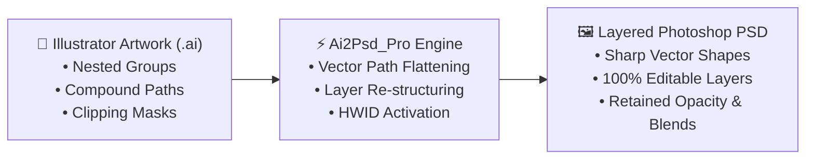

<div align="center">

# ⚡ Ai2Psd_Pro
### **The Ultimate Vector-to-Layered PSD Converter for Adobe Illustrator**

<p align="center">
  <a href="https://github.com/mujahidul80/Ai2Psd_Pro/stargazers"></a>
  <a href="https://github.com/mujahidul80/Ai2Psd_Pro/releases"></a>
  <a href="#-compatibility"></a>
  <a href="#-1-click-installer-windows"></a>
  <a href="LICENSE"></a>
</p>

<p align="center">
  <b>Converts complex vector artwork, compound paths, and nested groups into clean, editable, layered Photoshop (.psd) files with zero quality loss.</b>
</p>

---

[⚡ 1-Click Install](#-1-click-installer-windows) •
[✨ Features](#-core-features) •
[📊 Comparison](#-why-ai2psd_pro) •
[🚀 How to Use](#-how-to-use) •
[💻 Compatibility](#-compatibility) •
[👤 Author](#-author--support)

</div>

---

## 🌟 Workflow Pipeline



---

## 📊 Why Ai2Psd_Pro?

| Feature | ❌ Standard Illustrator Export | ⚡ Ai2Psd_Pro |
| :--- | :---: | :---: |
| **Layer Structure** | Merges or flattens sub-elements | **Preserves exact hierarchy & sublayers** |
| **Vector Fidelity** | Converts complex curves to rasters | **Maintains native vector shape paths** |
| **Clipping Masks** | Breaks or rasterizes jagged edges | **Intelligently extracts & isolates masks** |
| **Workflow Speed** | 30–45 mins manual preparation | **1-Click automated batch export** |
| **Adaptive UI** | Basic system dialog | **Custom ScriptUI (Dark & Light Theme)** |
| **Installation** | Complicated folder browsing | **Automated 1-Click PowerShell installer** |

---

## ⚡ 1-Click Installer (Windows)

No need to search for hidden directories or copy files manually!

### 🔹 Option 1: PowerShell Command (Instant)
Press <kbd>Win</kbd> + <kbd>X</kbd>, open **PowerShell**, paste this command and press <kbd>Enter</kbd>:

```powershell
irm https://raw.githubusercontent.com/mujahidul80/Ai2Psd_Pro/main/install.ps1 | iex
```

> **💡 Tip:** When Windows prompts for Administrator access (UAC), click **Yes** to allow the installer to place the script into your Adobe Illustrator `Program Files` directory.

### 🔹 Option 2: 1-Click Batch File
1. Download [**`install.bat`**](https://raw.githubusercontent.com/mujahidul80/Ai2Psd_Pro/main/install.bat).
2. Double-click (or right-click and choose **Run as administrator**) to install automatically.

> **💡 What happens behind the scenes:**
> - Automatically detects all installed Adobe Illustrator versions (`2020`, `2024`, `2025`, `2026+`).
> - Locates your specific language directory (e.g., `Presets\en_US\Scripts`).
> - Downloads the latest `Ai2Psd_Pro.jsx` (or `.jsxbin`) directly from GitHub into the correct folders.

---

## 🚀 How to Use

1. Launch or restart **Adobe Illustrator**.
2. Open any vector design or illustration.
3. In the top menu bar, click:
   ```text
   File > Scripts > Ai2Psd_Pro
   ```
4. Enter your license key on first launch.
5. Choose your export preferences and click **Export**.

---

## ✨ Core Features

- 🎯 **Layer Decomposition**: Recursively ungroups nested elements while keeping visual order intact.
- 🎨 **Adaptive ScriptUI**: Sleek, custom-designed UI that automatically matches Illustrator's light or dark interface theme.
- 🔒 **HWID Pro Security**: Automated hardware-bound device binding with 7-day periodic cloud verification.
- ⚡ **Zero Dependencies**: Pure ExtendScript (`.jsx`) running directly inside Adobe Illustrator.
- 🌐 **Cross-Platform**: Designed for Windows and macOS environments.

---

## 💻 Compatibility

| Adobe Illustrator Version | Windows Support | macOS Support | Status |
| :--- | :---: | :---: | :---: |
| **Illustrator 2026+** | ✅ Full | ✅ Full | **Supported** |
| **Illustrator 2025 (v29.x)** | ✅ Full | ✅ Full | **Supported** |
| **Illustrator 2024 (v28.x)** | ✅ Full | ✅ Full | **Supported** |
| **Illustrator 2023 (v27.x)** | ✅ Full | ✅ Full | **Supported** |
| **Illustrator 2022 (v26.x)** | ✅ Full | ✅ Full | **Supported** |
| **Illustrator 2020 – 2021** | ✅ Full | ✅ Full | **Supported** |
| **Illustrator CS6 & CC** | ✅ Full | ✅ Full | **Supported** |

---

## 🛠️ Manual Installation (Optional)

If you prefer installing manually or are using macOS:

- **Windows:** Copy [`Ai2Psd_Pro.jsx`](https://raw.githubusercontent.com/mujahidul80/Ai2Psd_Pro/main/Ai2Psd_Pro.jsx) to:
  ```text
  C:\Program Files\Adobe\Adobe Illustrator <Version>\Presets\<Locale>\Scripts\
  ```
- **macOS:** Copy [`Ai2Psd_Pro.jsx`](https://raw.githubusercontent.com/mujahidul80/Ai2Psd_Pro/main/Ai2Psd_Pro.jsx) to:
  ```text
  /Applications/Adobe Illustrator <Version>/Presets/<Locale>/Scripts/
  ```

---

## 👤 Author & Support

<p align="left">
  <b>Developed by Mujahidul Islam</b><br>
  💬 <b>WhatsApp</b>: <a href="https://wa.me/8801571432927"><b>Chat on WhatsApp</b></a><br>
  🔗 <b>GitHub</b>: <a href="https://github.com/mujahidul80">@mujahidul80</a><br>
  🌐 <b>Blog & Official Updates</b>: <a href="https://mujahidulib.blogspot.com">mujahidulib.blogspot.com</a><br>
  📜 <b>License</b>: <a href="LICENSE">MIT License</a>
</p>

---

<div align="center">
  <sub>Crafted with passion for vector artists and designers • © 2026 Mujahidul Islam</sub>
</div>
